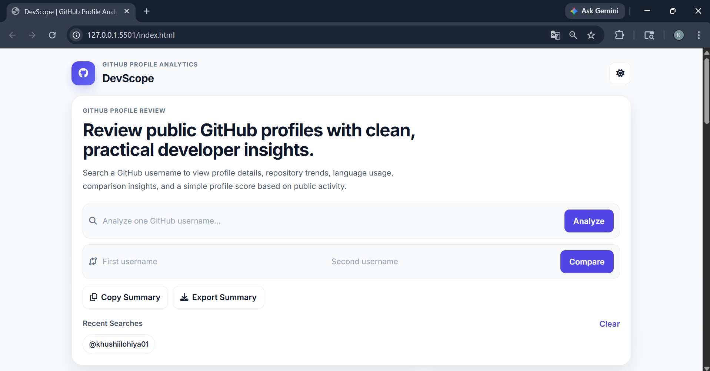
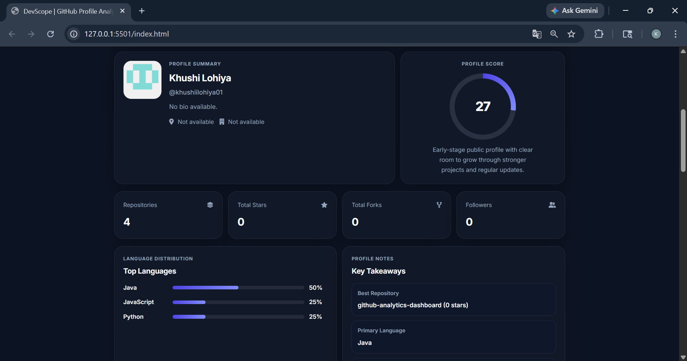
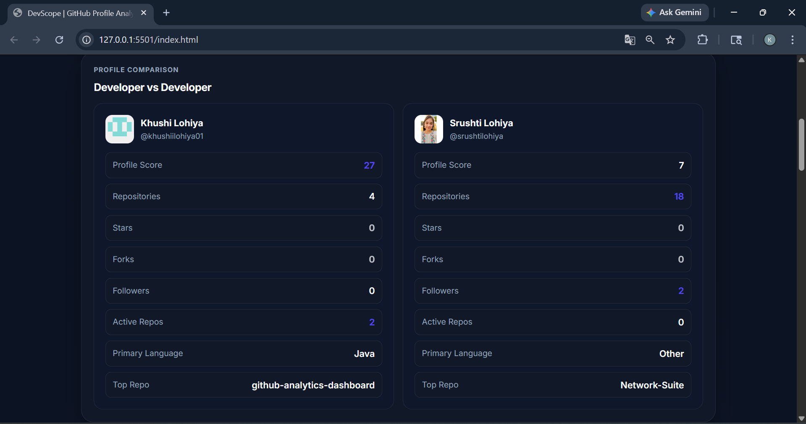
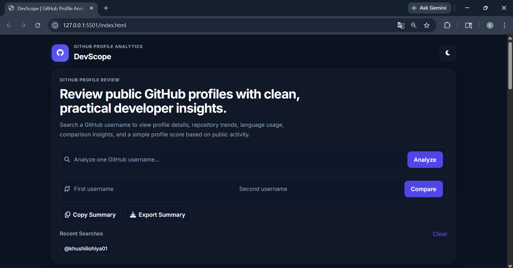

## DevScope 
GitHub Profile Analytics Dashboard

DevScope is a clean and responsive web application for reviewing public GitHub profiles. It highlights key profile details, repository statistics, language usage, contribution graph display, comparison insights, and an overall profile score based on public activity and visibility.

---

## Features

- Search any public GitHub profile
- View profile insights such as repositories, stars, forks, and followers
- Profile score based on activity, visibility, and repository quality
- Repo activity chart (repos by month of last push, past 12 months)
- Language distribution visualization
- Repository analysis with sorting and filtering
- Recent activity detection based on the latest push to each repository
- Forked repositories are excluded from the analysis
- Best repository recommendation
- Practical improvement suggestions
- Compare two GitHub profiles side by side
- Copy generated summary to clipboard
- Export profile summary as a text file
- Light / Dark mode toggle
- Recent searches stored in local storage
- Fully responsive layout

---

## Tech Stack

- HTML5
- CSS3
- Vanilla JavaScript (ES modules)
- GitHub REST API

---

## How to Run Locally

1. Clone the repository and open the folder
2. Serve the folder with a static server, for example VS Code Live Server or:

```bash
python -m http.server 5500
```

3. Open http://localhost:5500

The scripts are ES modules, so opening `index.html` directly from the file system (double-click) will not work; browsers block module loading from `file://` URLs.

No build step or dependencies are required.

---

## Project Structure

```
index.html            Page layout
style.css             Styles and light/dark theme
js/
  main.js             Entry point: event wiring, load and compare flows
  api.js              GitHub API requests and rate-limit handling
  analysis.js         Pure scoring and insight logic (no DOM access)
  storage.js          localStorage access for recent searches and theme
  ui.js               Messages, button states, loading/empty/error states
  state.js            Shared app state
  dom.js              Element references
  utils.js            Formatting and safe DOM helpers
  render/
    profile.js        Profile dashboard and summary text
    repos.js          Repository list, sorting and filtering
    charts.js         Language and activity charts
    compare.js        Side-by-side comparison cards
```

---

## What This Project Does

DevScope helps review public GitHub profiles in a more structured way. Instead of only showing raw GitHub data, it organizes profile information into a cleaner dashboard with:
- profile summary
- score breakdown
- repository insights
- comparison view
- repo activity chart
- practical suggestions for improvement

This makes it useful for portfolio review, internship preparation, and general developer profile analysis

---

## Use Cases
- Evaluate GitHub profiles for internships
- Analyze developer activity and contribution trends
- Compare developers side-by-side
- Improve personal portfolio presentation


---

## Limitations
- Works only with public GitHub profiles
- GitHub API rate limits apply (60 unauthenticated requests per hour; each profile uses 2, a comparison uses 4)
- Only the first 100 repositories of a profile are loaded
- No backend (pure frontend project)
- The activity chart counts each repository once, by its most recent push, so it is not a full commit history

---

## Future Improvements
- More detailed contribution analytics
- GitHub OAuth support
- PDF export
- Improved profile scoring logic
- Better visual comparison insights

---

## Preview
Home Dashboard


Analyzed Profile


Compare Profiles


Dark Mode View
