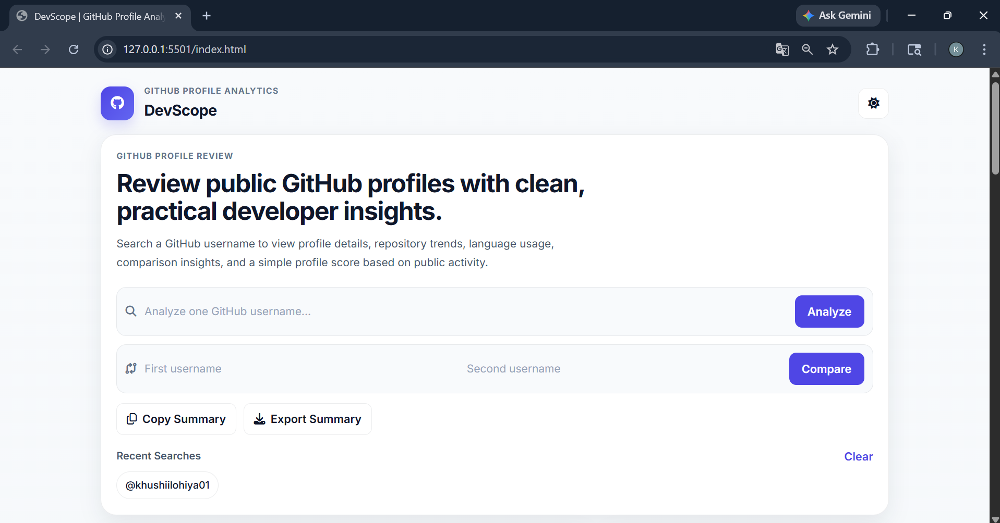
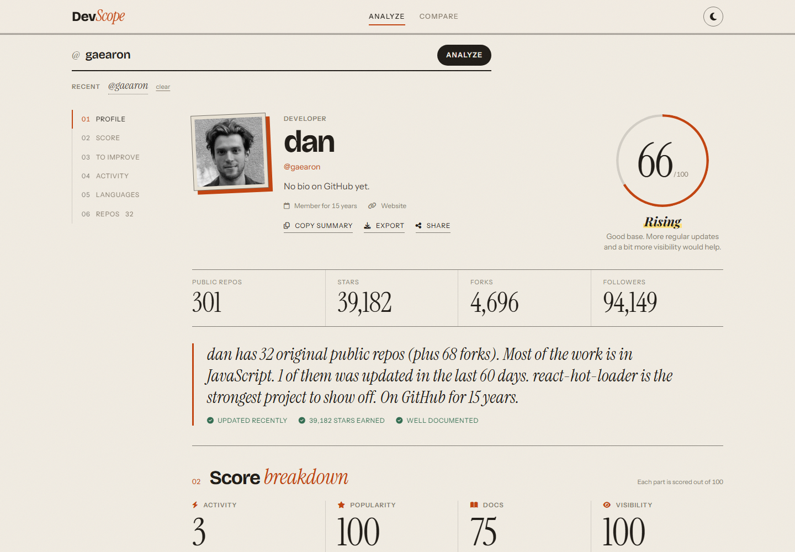
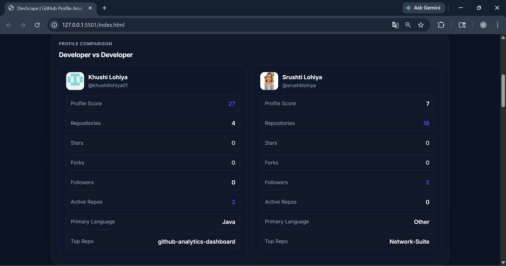
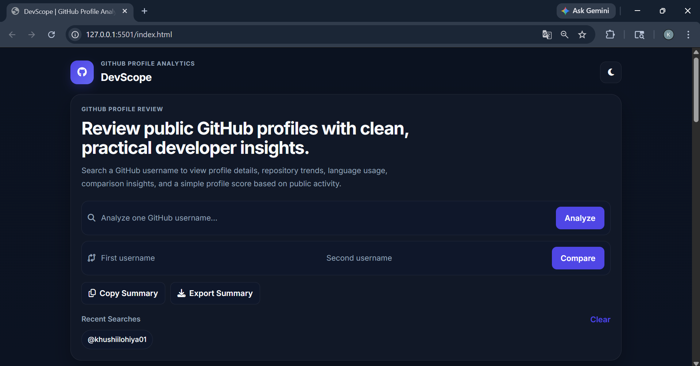

# DevScope

A small web app I built to see how a GitHub profile comes across. I started it to get my own profile ready for internship applications, but it works just as well the other way round, for recruiters looking at a candidate's GitHub. You type in a username and it gives a score out of 100, a look at the repos and languages, and where the profile could improve.

It runs entirely in the browser using the public GitHub API. No sign-in, no backend, and your recent searches stay in your browser's local storage.

## What it shows

- **Score out of 100**, split into activity, popularity, documentation and visibility, with the real numbers behind each part
- **Room to improve**: a few concrete suggestions, biggest wins at the top
- **Recent activity**: which months the repos were last updated in, over the past year
- **Languages and best repo**: the language mix and the repo that's most worth pinning
- **All repositories**, sortable and filterable by language
- **Compare**: two profiles side by side
- Copy or download a plain-text summary, or share a link to a profile
- Light and dark theme, works on phones

Forked repos are left out of the analysis, since they're mostly other people's work.

## Running it locally

The scripts are ES modules, so the page needs to be served over HTTP. Opening `index.html` by double-clicking won't work.

```bash
python -m http.server 5500
```

Then open http://localhost:5500. VS Code's Live Server works too.

There's no build step and nothing to install.

## Deploying

It's a static site, so any static host works. For GitHub Pages: push the repo, go to **Settings → Pages**, and pick the `main` branch with the root folder.

## How the score works

| Part | Based on |
|---|---|
| Activity | Share of your repos updated in the last 60 days |
| Popularity | Total stars and forks across your repos |
| Documentation | Share of your repos that have a description |
| Visibility | Followers and number of public repos |

The overall score weights these 30 / 28 / 20 / 22. It's a rough guide, not an official metric.

## Limitations

- Only public profiles and repos
- GitHub allows 60 unauthenticated API requests an hour. Each profile uses 2, a comparison uses 4.
- Only the first 100 repos of a profile are loaded
- The activity chart counts each repo once, in the month it was last pushed to, so it isn't a full commit history

## Project structure

```
index.html          Page markup
style.css           All styles, light and dark themes
js/
  main.js           Event handlers, loading and comparing profiles
  api.js            GitHub API calls and rate-limit handling
  analysis.js       Scoring and suggestions (no DOM code)
  scroll.js         Section nav, reading progress, scroll animations
  storage.js        Recent searches and theme in localStorage
  ui.js             Messages, buttons, loading and empty states
  state.js          Shared state
  dom.js            Element lookups
  utils.js          Formatting helpers
  render/
    profile.js      Profile section and the copyable summary
    repos.js        Repository list
    charts.js       Activity and language charts
    compare.js      Compare view
```

## Ideas for later

- Sign in with GitHub to raise the rate limit
- Look at commit history, not just the last push date
- PDF export

## Screenshots





